<div align="center">

# 🧺 Laundry-Robot-RL-Diffusion

### Three robot arms. A bucket of crumpled laundry. One question:
### **can scramble-inversion diffusion beat reinforcement learning at folding clothes — and at what cost?**

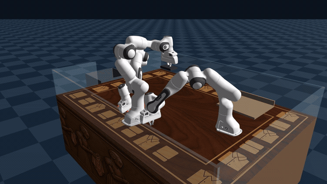

<sub>A 3-arm robotic laundry cell in [Genesis](https://genesis-embodied-ai.github.io/). Garments are picked from a bucket, untangled, ironed (with real burn physics), folded twice, and stacked on a linen shelf — by a learned policy.</sub>


-orange)


</div>

---

## 🎬 The full laundry loop

> **bucket → pick → uncrumple → iron (no skipped spots, burns if you dawdle) → fold → second fold → linen shelf**, one garment at a time.

<table>
<tr>
<td align="center" width="50%">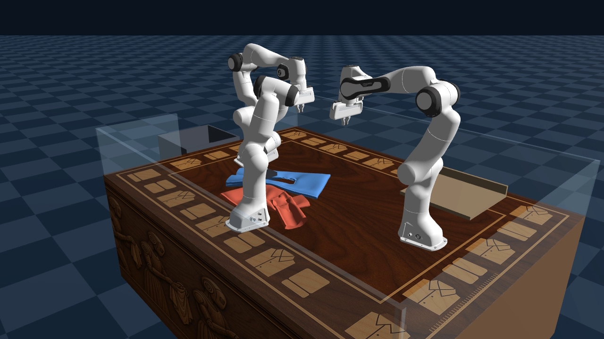<br><sub>The AI-textured work cell: marquetry-walnut top, carved-frieze sides, glass enclosure, bucket off the left rim, linen shelf back-right.</sub></td>
<td align="center" width="50%">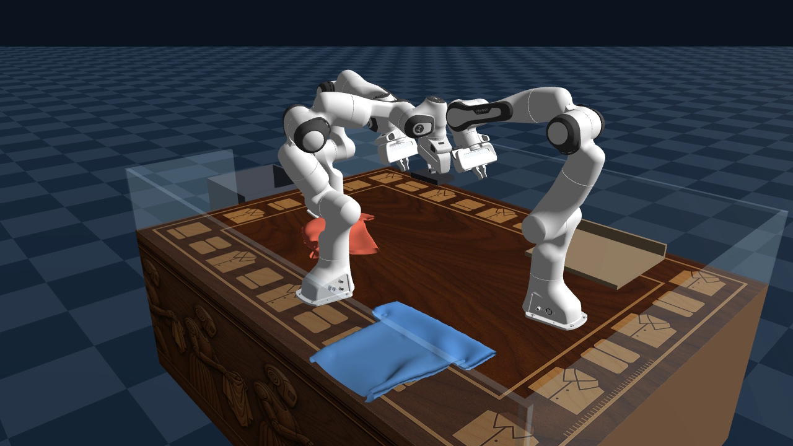<br><sub>Two-layer garments at 4× mesh resolution (~6,600 cloth particles), third arm ironing.</sub></td>
</tr>
</table>

---

## 🏆 The showdown: 3 garments × 3 policies

Every cell below is a **real evaluated episode**, identical tangle seeds across policies. Metric headline: **fold quality** (`fold_q`, higher = better) and **burns** (lower = safer).

<table>
<tr><th></th><th>🤖 RL (BC→SAC)</th><th>🌀 Diffusion</th><th>🎲 Random</th></tr>
<tr>
<td align="center"><b>🧻 Towel</b></td>
<td align="center">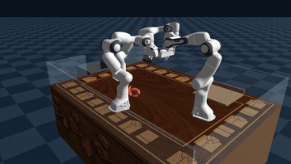<br><b>fold_q 0.422</b> 🥇<br>0 burns</td>
<td align="center">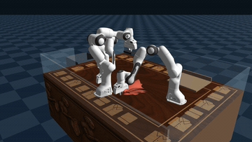<br>fold_q 0.395<br>0 burns</td>
<td align="center">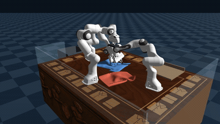<br>fold_q 0.372<br><b>306 burns</b> 🔥</td>
</tr>
<tr>
<td align="center"><b>👕 Shirt</b></td>
<td align="center">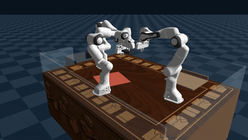<br>fold_q 0.305<br>0 burns</td>
<td align="center">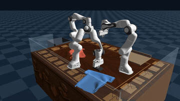<br><b>fold_q 0.330</b> 🥇<br>0 burns</td>
<td align="center">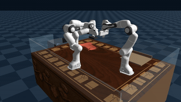<br>fold_q 0.309<br>0 burns</td>
</tr>
<tr>
<td align="center"><b>👖 Pants</b></td>
<td align="center">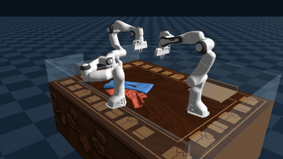<br><b>fold_q 0.311</b> 🥇<br>0 burns</td>
<td align="center">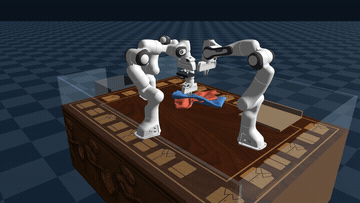<br>fold_q 0.300<br>0 burns</td>
<td align="center">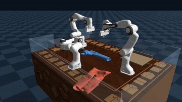<br>fold_q 0.353*<br>0 burns</td>
</tr>
</table>

<sub>*pants-random survived only 2 of 6 episodes before solver crashes — its "lead" rests on n=2 and is not credible.</sub>

---

## 📊 Results at a glance

```
fold quality (higher is better)          burns (lower is safer)
                                          
towel   RL   █████████████████ 0.422     RL        0
        DIFF ███████████████▌  0.395      DIFF      0
        RAND ██████████████▌   0.372      RAND  ▇▇▇▇▇▇▇ 306 🔥
                                          
shirt   DIFF ████████████▊     0.330      every learned policy:  0 burns
        RAND ███████████▉      0.309      random (all garments): 306 burns total
        RL   ███████████▊      0.305
```

| What round 2 proved | Evidence |
|---|---|
| 🥇 **First genuine RL win in the whole project** | Towels, via **behavior-clone the diffusion policy → fine-tune with SAC**. Pure RL never beat anything in 4 prior rounds. |
| 🌀 **Fixing the training distribution rescued diffusion** | Shirts flipped from a round-1 *deficit* (0.305 vs 0.334) to a *lead* (0.330 vs 0.309) by training on arm-dropped states instead of teleported scrambles. |
| 🛟 **Structure buys safety before skill** | **0 burns** across all 6 learned configs vs **306** for random — third consecutive demonstration. |
| 🧱 **The visual ceiling is the physics engine, not the policy** | Best SSIM-to-ideal anywhere is 0.064 vs ~0.40 for a settled perfect fold. Nobody folds *pretty* yet. |
| 💥 **RL stays fragile where diffusion doesn't** | Every solver-explosion crash in learned evals came from RL. Diffusion: 18/18 clean episodes. |

### 💰 And the cost, which is the whole point

| | 🌀 Diffusion | 🤖 RL |
|---|---|---|
| Training interactions | **0 robot actions** (armless synthetic scrambles) | ~1,700 arm actions |
| Wall-clock to train | ~2 h collect + minutes | days, with babysitting |
| Per sample | ~1–3 s (teleport) | 30–100 s (real arm) |
| Crashes | never | occasionally |
| **Scales with** | sim stability (fixable) | robot time (expensive) |

> **Verdict:** Diffusion is the best default — ~50× cheaper, never crashes, wins shirts. RL is only viable *warm-started from diffusion*. The production recipe this project recommends is the **hybrid: behavior-clone the diffusion policy, then SAC fine-tune.**

---

## 🧠 How it works

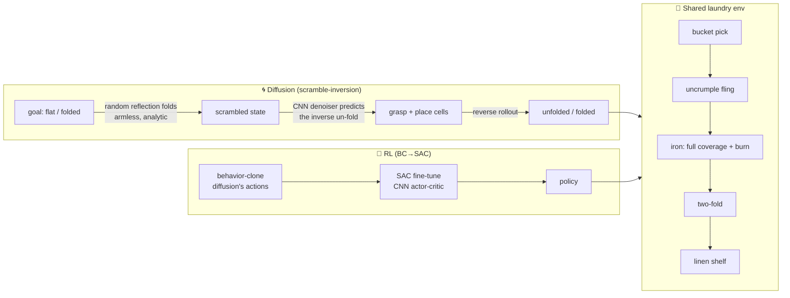

- **Diffusion** trains a 4-conv CNN to predict the inverse of a random reflection-fold, as four 16×16 grasp/place cell distributions, then runs it as a reverse diffusion rollout. All training data is **synthetic and armless** — the source of its ~50× cost advantage.
- **RL** is SAC over manipulation primitives with a CNN heightmap encoder. It only learns anything when **behavior-cloned from the diffusion policy first**.
- **The env** is the hard part: PBD cloth that explodes when folds stack, a third arm that irons with real per-particle heat/burn, and a bucket→shelf pipeline. See [`docs/CLOTH_ENGINE_REQUIREMENTS.md`](docs/CLOTH_ENGINE_REQUIREMENTS.md) for the stability lessons that cost a week.

---

## 📂 Repository layout

```
src/        the full pipeline — scenes, primitives, envs, SAC, denoisers,
            collectors, trainers, evals  (39 scripts, every stage reproducible)
models/     round-2 deliverables — 3 uncrumple + 3 fold denoisers (~0.5 MB each),
            2 BC actors, 3 SAC checkpoints
meshes/     procedural garments — tshirt4 / pants4 / towel4 (4× two-layer)
textures/   5 AI-generated albedo table textures + UV veneer quads
results/    the 9-config raw eval JSONs (fold_q, SSIM, burns, crashes)
media/      9 showcase GIFs + hero + scene stills
docs/       RESULTS_*.md, CLOTH_ENGINE_REQUIREMENTS.md, and the
            full project PDF (R1 + R2, R2 includes a 10-question quiz)
```

---

## 🚀 Quickstart

```bash
# Genesis + PyTorch env (RTX-class GPU recommended)
pip install genesis-world torch gymnasium numpy trimesh imageio

# evaluate the towel RL winner (reproduces fold_q 0.422)
python src/eval_laundry.py --actor models/sac_towel_380.pt \
    --garment towel4.obj --episodes 6 --out /tmp/eval.json

# run the diffusion policy on shirts (its win)
python src/eval_laundry.py --mode diffusion \
    --uncrumple models/uncrumple_tshirt4.pt --fold models/fold_tshirt4.pt \
    --garment tshirt4.obj --episodes 6 --out /tmp/eval.json

# record a video (any config): add  --video out.mp4 --episodes 1
```

---

## 🔭 What's next

The single highest-leverage improvement is a **cloth engine that stays stable when folds stack at full resolution** — detailed with a validation suite in [`docs/CLOTH_ENGINE_REQUIREMENTS.md`](docs/CLOTH_ENGINE_REQUIREMENTS.md). It would unlock full-resolution folded-goal data, which is diffusion's *only* real bottleneck. On the RL side, pixel-wise Q-maps remain the untried upgrade.

---

<div align="center">
<sub>Built in <a href="https://genesis-embodied-ai.github.io/">Genesis</a> on a single RTX 5080. Scramble-inversion diffusion follows the method of Zenodo <a href="https://zenodo.org/records/21970238">21970238</a> / <a href="https://zenodo.org/records/22063663">22063663</a>.</sub><br>
<sub>Full write-up: <a href="docs/cloth_robot__ALL_DETAILS_R2.pdf">cloth_robot__ALL_DETAILS_R2.pdf</a></sub>
</div>
